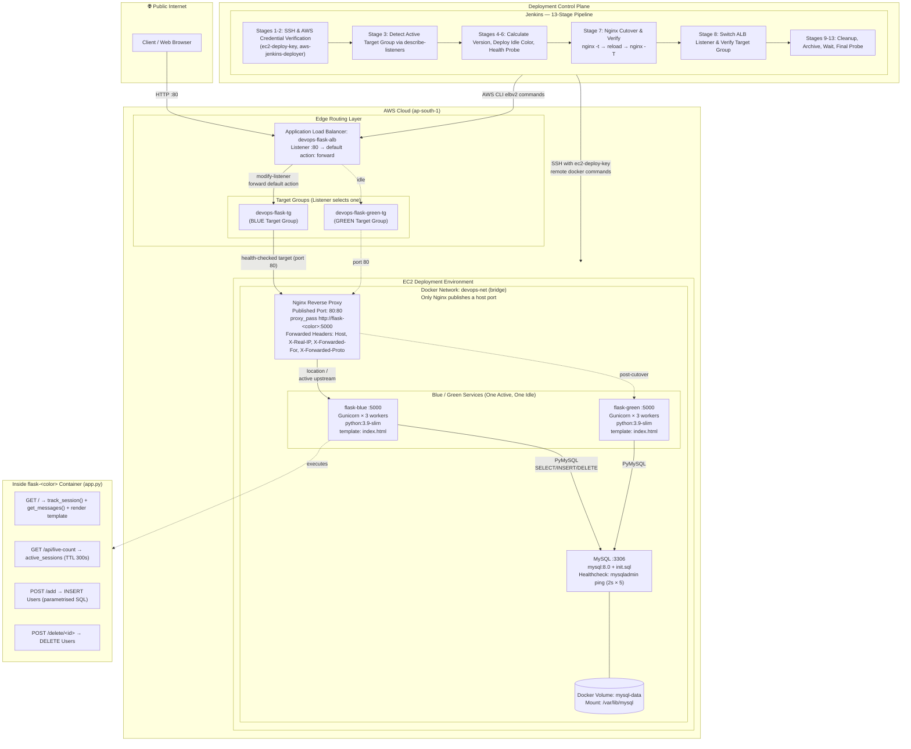
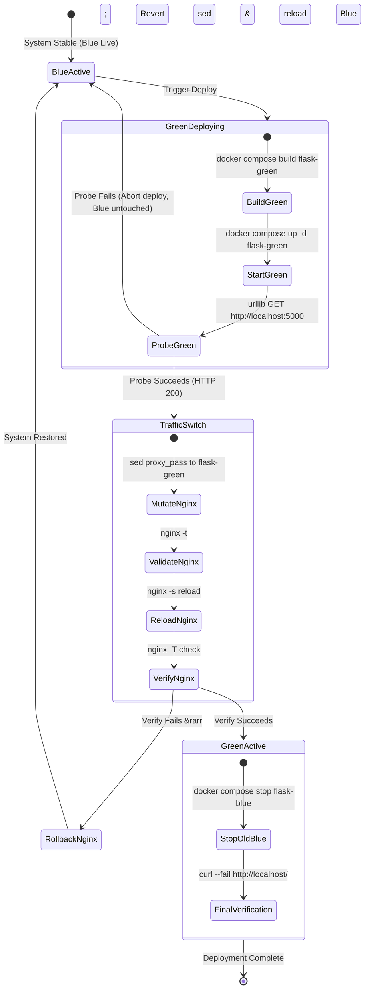
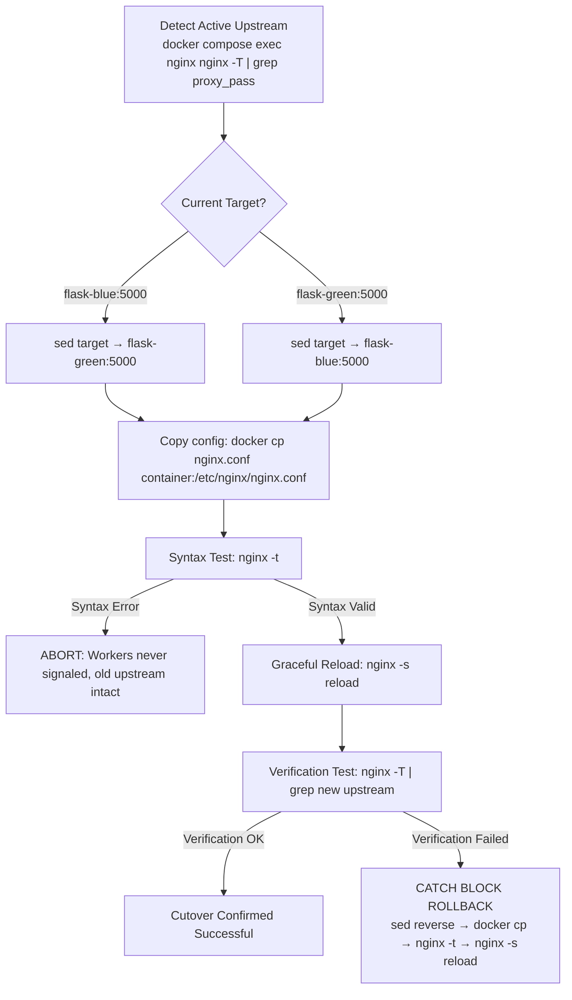
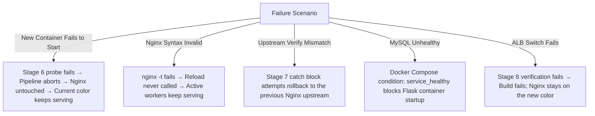

# FeedBoard

> **Blue/Green Deployment Reference**
> A Flask message board demonstrating health-gated deployments with Docker Compose, Nginx, an AWS Application Load Balancer (ALB), and a 13-stage Jenkins pipeline.

---

## Table of Contents

1. [Architecture Overview](#architecture-overview)
2. [End-to-End Architecture Diagram](#end-to-end-architecture-diagram)
3. [Infrastructure Layers Explained](#infrastructure-layers-explained)
   - [Layer 1: Edge & Ingress Routing (AWS ALB)](#layer-1-edge--ingress-routing-aws-alb)
   - [Layer 2: Reverse Proxy & Dynamic Upstream Switching (Nginx)](#layer-2-reverse-proxy--dynamic-upstream-switching-nginx)
   - [Layer 3: Application Runtime & Containers (Flask / Gunicorn)](#layer-3-application-runtime--containers-flask--gunicorn)
   - [Layer 4: Data Persistence & Storage (MySQL 8.0)](#layer-4-data-persistence--storage-mysql-80)
    - [Layer 5: Deployment Control Plane (Jenkins)](#layer-5-deployment-control-plane-jenkins)
4. [Dual-Layer Routing Mechanics (ALB + Nginx)](#dual-layer-routing-mechanics-alb--nginx)
5. [End-to-End Request Lifecycle](#end-to-end-request-lifecycle)
6. [Blue/Green Deployment Strategy & Invariants](#bluegreen-deployment-strategy--invariants)
7. [Nginx Atomic Cutover & Idempotent Mechanics](#nginx-atomic-cutover--idempotent-mechanics)
8. [Jenkins 13-Stage Deployment Pipeline](#jenkins-13-stage-deployment-pipeline)
9. [Application Specifications & API](#application-specifications--api)
10. [Database Architecture & Schema Safety](#database-architecture--schema-safety)
11. [Failure Modes & Recovery Behavior](#failure-modes--recovery-behavior)
12. [Local Development & Manual Testing](#local-development--manual-testing)
13. [Production Hardening & Architectural Trade-offs](#production-hardening--architectural-trade-offs)
14. [Known Limitations](#known-limitations)
15. [Repository Structure](#repository-structure)

---

## Architecture Overview

FeedBoard demonstrates blue/green application deployment. Docker Compose runs both application colors, MySQL, and Nginx; Jenkins coordinates deployment and AWS ALB listener changes while Nginx handles the active/inactive app switch.

### Deployment Characteristics

* **Health-gated application switch:** Jenkins probes the idle application container before changing Nginx's upstream.
* **Single published application entry point:** Nginx publishes host port `80`; the application and MySQL containers use the private Compose network.
* **Nginx rollback:** The Nginx cutover stage attempts to restore the previous upstream if its switch or verification fails.
* **Persistent database volume:** MySQL stores data in the Compose-managed named volume `mysql-data`, which is retained when application containers are recreated.
* **Shared database:** Blue and green use the same persistent MySQL database.

---

## End-to-End Architecture Diagram



---

## Infrastructure Layers Explained

### Layer 1: Edge & Ingress Routing (AWS ALB)
* **Application Load Balancer (`devops-flask-alb`):** Situated in AWS region `ap-south-1`. Terminates public client HTTP traffic on port 80.
* **Target Groups:** 
  * `devops-flask-tg` (Blue role)
  * `devops-flask-green-tg` (Green role)
* In the deployed setup, both target groups register an EC2 endpoint on port 80; the listener selects which target group receives traffic.
* Jenkins changes and verifies the default listener action through AWS ELBv2 APIs. The Nginx upstream selects the application color.

### Layer 2: Reverse Proxy & Dynamic Upstream Switching (Nginx)
* **Role:** Host-level ingress and reverse proxy deployed via Docker.
* **Port Binding:** Maps `80:80` on the EC2 host.
* **Security Isolation:** Prevents direct public access to application workers or the database.
* **Dynamic Configuration:** Houses a minimal `nginx.conf` that points to `http://flask-blue:5000` or `http://flask-green:5000`. Cutovers happen in-place using atomic file copies and `nginx -s reload`.

### Layer 3: Application Runtime & Containers (Flask / Gunicorn)
* **Base Image:** `python:3.9-slim`.
* **Application Server:** **Gunicorn** with 3 worker processes (`gunicorn --bind 0.0.0.0:5000 --workers 3 app:app`).
* **Same application behavior:** Both colors run the same image and render `templates/index.html`. The `APP_TEMPLATE` variable in Compose is not read by `app.py`.
* **Port:** Container-internal port `5000` (not published to the host).

### Layer 4: Data Persistence & Storage (MySQL 8.0)
* **Engine:** Official `mysql:8.0` container with schema auto-seeded via `sql/init.sql`.
* **Health Check:** Container-native `mysqladmin ping` probe ensures MySQL is fully accepting connections before Flask containers start.
* **Data Volume:** Docker named volume `mysql-data` maps to `/var/lib/mysql`, ensuring database records persist across reboots, builds, and blue/green rotations.

### Layer 5: Deployment Control Plane (Jenkins)
* **Jenkins:** Executes the 13-stage deployment pipeline using its credential store:
  * `ec2-deploy-key`: SSH private key for remote EC2 orchestration.
  * `aws-jenkins-deployer`: IAM credentials with scoped permissions for AWS ELBv2.

---

## Dual-Layer Routing Mechanics (ALB + Nginx)

A central architectural question in this setup is: **Why are both AWS ALB Target Groups and an internal Nginx reverse proxy used?**

```
Client
  │
  ▼
[AWS ALB :80] 
  │  (Listener forward rule points to Target Group)
  ▼
[Target Group: devops-flask-tg or devops-flask-green-tg]
  │  (Both Target Groups forward to EC2 Host Port 80)
  ▼
[EC2 Host Port 80 &rarr; Nginx Container]
  │  (Nginx proxy_pass switches between flask-blue and flask-green)
  ▼
[flask-blue:5000 OR flask-green:5000]
```

### Architectural Rationale

1. **Outer Cloud Layer (ALB Target Groups):**
   * Mirrors enterprise multi-instance and multi-AZ architectures where the ALB routes traffic to whole environment clusters.
   * Tracks environment state at the cloud control plane level (`describe-listeners`).
2. **Inner Host Layer (Nginx Reverse Proxy):**
    * Provides one published port-80 entry point and forwards requests to the configured application service.
    * Nginx reloads its configuration gracefully. Existing workers can finish active requests, but this is not an absolute guarantee of zero dropped connections.
   * Injects standardized proxy headers (`X-Real-IP`, `X-Forwarded-For`, `X-Forwarded-Proto`) so backend applications have full visibility of true client IPs.

---

## End-to-End Request Lifecycle

```mermaid
sequenceDiagram
    autonumber
    actor Client as Client / Browser
    participant ALB as AWS ALB (:80)
    participant NGINX as Nginx (:80)
    participant APP as Flask Container (:5000)
    participant DB as MySQL (:3306)

    Client->>ALB: HTTP GET /
    Note over ALB: Listener evaluates default action & forwards to active Target Group
    ALB->>NGINX: Forward to EC2 Target (:80)
    Note over NGINX: Evaluates location / and passes to active upstream (flask-<color>:5000)
    NGINX->>APP: proxy_pass with Host & X-Forwarded headers
    APP->>APP: track_session() &rarr; generate/refresh session UUID
    APP->>DB: SELECT id, name FROM Users ORDER BY id
    DB-->>APP: Query result set
    APP->>APP: render_template("index.html")
    APP-->>NGINX: HTTP 200 OK + HTML payload
    NGINX-->>ALB: HTTP 200 OK
    ALB-->>Client: HTTP 200 OK (Rendered UI)
```

---

## Blue/Green Deployment Strategy & Invariants



### The Non-Negotiable Deployment Invariants

1. **Isolation During Build:** Building or restarting the idle container never impacts the live container.
2. **Pre-Flight Health Probe:** The new container must prove it returns `200 OK` via internal HTTP probe before Nginx configuration is modified.
3. **Graceful Worker Drain:** `nginx -s reload` signals existing Nginx master processes to spawn new workers for incoming requests while allowing existing workers to drain active connections.
4. **Delayed Teardown:** `docker compose stop flask-<old_color>` is executed *only* after traffic verification succeeds.

---

## Nginx Atomic Cutover & Idempotent Mechanics

The cutover script dynamically determines which container is active by querying the live running Nginx process:



### Idempotency Principles

* **No Assumed State:** The pipeline discovers state dynamically using `nginx -T`. It does not rely on flags or files that might become desynchronized.
* **Atomic Reload:** Nginx applies configuration changes in memory without killing the master process or closing the listening socket.
* **Automatic Rollback:** The Jenkins stage wraps the cutover in a `try/catch` block. Any failure during reload or verification reverses the `sed` modification and restores the prior upstream.

---

## Jenkins 13-Stage Deployment Pipeline

The deployment pipeline defined in [Jenkinsfile](Jenkinsfile) consists of 13 stages. The idle application is deployed and health-checked before Nginx and the ALB are switched:

| Stage # | Stage Name | Purpose & Commands | Failure Action |
| :---: | :--- | :--- | :--- |
| **1** | **Test EC2 SSH Access** | Validates SSH connectivity to EC2 (`whoami`, `hostname`, `docker compose ps`). Uses credentials `ec2-deploy-key`. | Aborts build immediately if SSH unreachable. |
| **2** | **Test AWS Access** | Executes `aws sts get-caller-identity` and lists target groups with `aws elbv2 describe-target-groups`. | Aborts build if AWS credentials invalid. |
| **3** | **Detect ALB Active Environment** | Queries `describe-listeners` to determine whether ALB is pointing to `devops-flask-tg` or `devops-flask-green-tg`. | Fails if unknown target group returned. |
| **4** | **Calculate Build Version** | Extracts Git commit hash (`git rev-parse --short HEAD`) for deployment tracking. | Fails if Git repository metadata is missing. |
| **5** | **Deploy Application** | Discovers the Nginx-active color, ensures MySQL is running, then builds and starts the idle color. | Fails if image build or container startup fails. |
| **6** | **Health Check New Environment** | Probes the idle container over the internal bridge network using Python `urllib`. | Fails before traffic changes; the current Nginx upstream remains active. |
| **7** | **Switch Nginx Traffic and Verify** | Updates `nginx.conf`, validates it with `nginx -t`, reloads Nginx, and verifies the live upstream. | Attempts to restore the previous Nginx upstream if cutover verification fails. |
| **8** | **Switch ALB Traffic** | Changes the listener default action to the target group for the new color and verifies it with `describe-listeners`. | Fails if the target group ARN does not match; this stage does not roll back the completed Nginx cutover. |
| **9** | **Cleanup Old Environment** | Stops the old color after both traffic switches succeed. | A cleanup failure fails this stage; the new color is already active. |
| **10** | **Create Build Artifact** | Generates `build-info.txt` containing `BUILD_NUMBER` and `GIT_COMMIT`. | Artifact tracking step. |
| **11** | **Archive Artifact** | Stores `build-info.txt` in Jenkins build history via `archiveArtifacts`. | Fails if Jenkins cannot archive the artifact. |
| **12** | **Wait for Services** | Executes `sleep 10` before the final endpoint check. | Fixed delay; not a health check by itself. |
| **13** | **Final Health Check** | Runs `curl --fail --silent http://localhost/` through Nginx on the EC2 host. | Fails the build if the endpoint check fails. |

---

## Application Specifications & API

The application is written in Python using Flask and PyMySQL, served by Gunicorn.

### Endpoints

| Method | Endpoint | Description | Request / Response Format |
| :--- | :--- | :--- | :--- |
| `GET` | `/` | Renders the message board UI with live session count and random joke. | Returns HTML from `templates/index.html`. |
| `GET` | `/api/live-count` | Returns active visitor count based on sliding 300s TTL. | `{"count": 3}` (JSON) |
| `POST` | `/add` | Inserts a new user/message into the database. | Body: `{"message": "Hello"}` &rarr; Returns updated message array. |
| `POST` | `/delete/<id>` | Deletes an existing record by primary key ID. | Returns updated message array. |

Both application colors currently render `templates/index.html`. Although Compose sets `APP_TEMPLATE` for `flask-green`, `app.py` does not read that variable, so the page appearance is not an environment-color indicator.

---

## Database Architecture & Schema Safety

The database layer runs on official MySQL 8.0, initialized via `mysql/Dockerfile` and `sql/init.sql`:

```sql
CREATE TABLE IF NOT EXISTS Users (
    id INT PRIMARY KEY AUTO_INCREMENT,
    name VARCHAR(100)
);

INSERT INTO Users (name) VALUES ('Prakhar'), ('Bhavya'), ('Red');
```

### Blue/Green Database Guidelines

Because both Blue and Green containers connect to the **same underlying MySQL instance**, database migrations must adhere to the **Expand/Contract** pattern:
1. **Never make breaking schema changes in a single deploy** (e.g. dropping columns or renaming fields).
2. **Phase 1 (Expand):** Add new nullable columns or tables; Blue and Green can both read/write safely.
3. **Phase 2 (Cutover):** Deploy new code that writes to new fields.
4. **Phase 3 (Contract):** Deprecate and drop obsolete columns in a subsequent maintenance cycle.

---

## Failure Modes & Recovery Behavior



| Failure Event | Detection Point | Automated Recovery Action | Impact on End User |
| :--- | :--- | :--- | :--- |
| **New Container Crash on Boot** | Stage 6: Python `urllib` probe fails | Jenkins aborts before Nginx or ALB traffic switches. | Current color remains active. |
| **Corrupted `nginx.conf`** | Stage 7: `nginx -t` validation fails | Jenkins catch block attempts to restore the previous config; reload is not performed with invalid config. | Existing Nginx workers continue with their loaded configuration if rollback succeeds. |
| **Post-Cutover Mismatch** | Stage 7: `nginx -T` verification fails | Jenkins catch block attempts rollback to the previous upstream. | Recovery depends on the rollback commands succeeding. |
| **ALB Switch Fails** | Stage 8: listener verification fails | Jenkins fails the build; the Nginx cutover is not automatically reverted. | Nginx continues routing to the new color; both ALB target groups forward to the Nginx endpoint. |
| **MySQL Unavailable** | Docker health check (`mysqladmin ping`) | `depends_on: condition: service_healthy` prevents Flask start until DB is ready. | Prevents broken containers from booting. |

---

## Local Development & Manual Testing

### 1. Prerequisites & Environment Setup
Clone the repository and create the local environment file, then populate it from your approved secret source:

```bash
git clone https://github.com/2117Duppy/FeedBoard.git
cd FeedBoard
touch .env
```

Compose requires `MYSQL_ROOT_PASSWORD`, `MYSQL_DATABASE`, and `MYSQL_USER`. Keep real values in the ignored `.env` file and do not commit them. `MYSQL_USER` must identify a MySQL account available to the app; Compose currently passes only the root password and database name to the MySQL service.

### 2. Build and Start Services
Launch all four services (`mysql`, `flask-blue`, `flask-green`, `nginx`):

```bash
docker compose up --build -d
```

Check running services:
```bash
docker compose ps
```

Visit the application locally at: **`http://localhost`** (routes by default to `flask-blue`).

### 3. Simulate a Manual Nginx Cutover
Edit `nginx/nginx.conf` and change the `proxy_pass` upstream from `flask-blue:5000` to `flask-green:5000`, then copy and reload the configuration:

```bash
docker compose cp ./nginx/nginx.conf nginx:/etc/nginx/nginx.conf
docker compose exec nginx nginx -t
docker compose exec nginx nginx -s reload
docker compose exec nginx nginx -T | grep proxy_pass
```

The live configuration output should show `flask-green:5000`. Both colors currently render the same template, so use the Nginx upstream configuration to confirm the active color. MySQL data remains in the Compose-managed named volume.

---

## Production Hardening & Architectural Trade-offs

| Component | Current Implementation | Production Hardening Recommendation |
| :--- | :--- | :--- |
| **Session Tracking** | In-process Python dictionary (`active_sessions`) | Deploy a shared **Redis** or **AWS ElastiCache** instance so session counts survive cutovers across containers. |
| **Database Architecture** | Single-container MySQL on EC2 with Docker volume | Migrate to **Amazon RDS Multi-AZ (MySQL)** for automated backups, read replicas, and failover capabilities. |
| **Deployment Availability** | No automated host failover | Deploy Blue and Green as separate Auto Scaling Groups (ASGs) behind ALB Target Groups across multiple Availability Zones. |
| **Configuration Delivery** | Host-level `sed` on `nginx.conf` | Use environment template generators (e.g. `envsubst` or Consul Template) or service meshes (e.g. Envoy, AWS ECS Service Connect). |
| **Host Access Security** | SSH via private key (`ec2-deploy-key`) | Use **AWS Systems Manager (SSM) Session Manager** to eliminate the need for open SSH ports (port 22) and static keys. |

---

## Known Limitations

* **Host availability:** The deployment does not provide automated host-level failover.
* **ALB scope:** Both target groups forward to the Nginx endpoint. The ALB switch does not select separate color fleets; Nginx selects the application color.
* **Partial rollback boundary:** If the ALB switch fails after the Nginx cutover, Jenkins reports failure but does not automatically restore the previous Nginx upstream.
* **In-process sessions:** `active_sessions` is a Python dictionary local to each Gunicorn worker, so counts are not shared across workers or application colors.
* **Fixed wait:** The pipeline uses a fixed `sleep 10` before its final health check rather than polling with a timeout.
* **Build tracking:** Jenkins records the Git revision in its build output/artifact, but the application image is not tagged with that revision.
* **SSH host verification:** Jenkins uses `StrictHostKeyChecking=no`; production deployments should verify and pin the host key or use SSM.

## Repository Structure

```
.
├── .github/
│   └── workflows/
│       └── ci.yml               # Legacy GitHub Actions workflow; not the deployment pipeline
├── mysql/
│   └── Dockerfile               # MySQL 8.0 custom Dockerfile with init scripts
├── nginx/
│   └── nginx.conf               # Minimal reverse proxy configuration with forwarded headers
├── sql/
│   └── init.sql                 # Database table definition and seed records
├── templates/
│   ├── index.html               # Template rendered by both application colors
│   └── index-green.html         # Alternate template, currently unused by app.py
├── app.py                       # Flask web application, session tracking, & SQL queries
├── docker-compose.yml           # Multi-container orchestration (MySQL, Blue, Green, Nginx)
├── Dockerfile                   # Application container definition (Python 3.9 + Gunicorn)
├── Jenkinsfile                  # 13-stage Jenkins automated blue/green deployment pipeline
├── requirements.txt             # Python runtime dependencies (Flask, Gunicorn, PyMySQL)
└── README.md                    # System documentation and infrastructure specification
```
